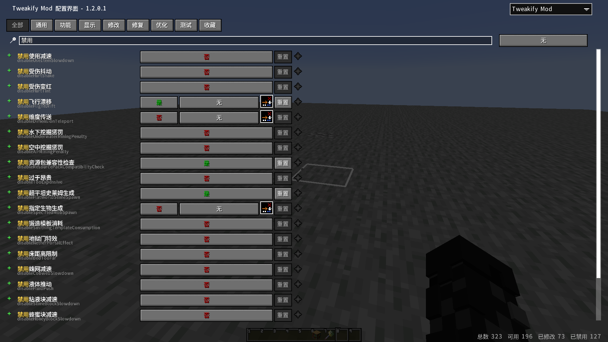
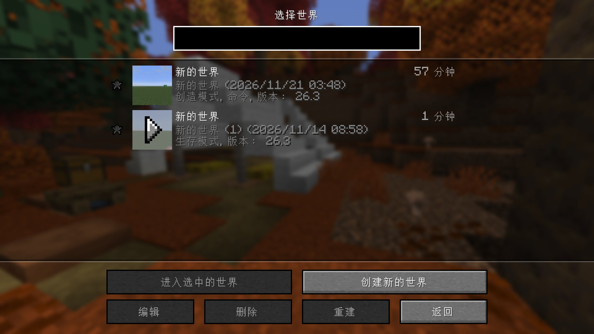

<div align="center">


# Tweakify Mod

**把原版里零散、不可配置的行为，整理成可开关、可绑定快捷键的选项。**


</div>

[快速开始](#quick-start) · [界面预览](#screenshots) · [功能一览](#features) · [配置文件](#config-file) · [环境要求](#requirements) · [命令](#commands)

> 纯客户端模组（`environment: client`），专用服务器无需安装；涉及服务端判定的功能仅在单人 / 局域网世界生效。

<a name="quick-start"></a>

## 🚀 快速开始

1. 安装 **Fabric Loader**（>= 0.20.1），用它启动 Minecraft **26.3**（需要 Java 25 运行时）。
2. 从 [Releases](https://github.com/Gtzc-114514/tweakify-mod/releases) 下载本模组的 jar，连同必需的 **Fabric API** 一起放进 `.minecraft/mods/`。
3. 安装 **MaLiLib**（必需，配置界面依赖它），同样放进 `mods/`。
4. 可选：安装 **Mod Menu**，在模组列表里获得本模组的配置入口；不装也能用 `G + C` 或 `/fconfig` 打开配置界面。

进游戏后按 `G + C` 打开配置界面即可开始调整；完整版本要求见下方「环境要求」一节。

<a name="screenshots"></a>

## 📷 界面预览

| 配置界面 | 存档列表 |
| --- | --- |
|  |  |
| 9 个标签页、关键词高亮与行内收藏星 | 每个存档的游玩时长、收藏置顶与收藏保护 |

## ✨ 功能概览

功能按配置界面顶部的标签分 8 类，完整清单见[功能一览](#features)。

| 标签 | 主要能力 |
| --- | --- |
| 功能 | 手持物品信息、背包快捷右键、交互冷却与副手回退、如履平地、更好的攀爬、主动爬行、相机运动、计时、附魔台信息、存档时长、维度传送、刷怪蛋、物品分组、创造飞行穿墙、更好的定位栏、聊天框消失进度条、辅助方块选区、NBT 自动补全、更好的盔甲架（姿态/红石/手臂） |
| 显示 | 攻击范围、爆炸范围、横扫范围、单层基岩、屏障可见、方块轮廓、实体高亮、区块中心、雕刻书架可视化 |
| 修改 | 使用物品不减速、飞行漂移、疾跑视野、挖掘打断、鞘翅水中飞行、附魔/铁砧限制、掉落物寿命、生物生成、移动物理、不死图腾、耕地踩踏、隐藏展示框、禁用玩家盔甲渲染、物品数量缩放、跳过实验性提示、潜行不隐藏名字、更好的进度、聊天签名隐藏、自定义游戏图标 |
| 修复 | 草径卡船、聊天卡顿、经验条溢出、书本居中、鱼线悬空、树苗生长、长矛伤害与击退等原版问题 |
| 优化 | MiniHUD 掉帧优化、告示牌文本优化、消耗品优化 |
| 通用 | 界面语言、配置快捷键、标签与滚动记忆、搜索高亮、平滑滚动（含进度界面）、快速滚动、收藏系统（星标样式/包含子项） |
| 测试 | 调试 HUD、钩子探针与报表、配置档案编辑器 |
| 收藏 | 手动收藏的配置项（点击配置行右侧星标收藏/取消；存档列表左侧的星标可收藏存档并置顶，收藏的存档不可删除） |

<a name="requirements"></a>

## 🧩 环境要求

| 项 | 版本 |
| --- | --- |
| Tweakify Mod | 1.2.7 |
| Minecraft | 26.3 |
| Fabric Loader | >= 0.20.1 |
| Fabric API | 0.163.0+26.3 |
| MaLiLib | 0.30.2（必需） |
| Mod Menu | 21.0.0（可选，仅用于提供模组列表入口） |
| MiniHUD | 0.41.2（可选，仅用于 MiniHUD 掉帧优化） |
| Java | 25 |

<a name="features"></a>

## ✨ 功能一览

完整的功能与配置项表格（按配置界面标签分类，含类型与默认值）见
[`docs/features.md`](docs/features.md)。表格较大，已独立成页，便于检索与回填。

<a name="commands"></a>

## 🧾 命令

| 命令 | 说明 |
| --- | --- |
| `/tweakify <开关>` | 切换指定开关（需权限等级 ≥2，OP 满足；单人世界房主自动放行） |
| `/tweakify <开关> <true\|false>` | 直接设置 |
| `/tweakify restrictedOffhandItems add <物品>` | 加入受限副手列表 |
| `/tweakify restrictedOffhandItems remove <物品>` | 移出受限副手列表 |
| `/tweakify restrictedOffhandItems list [页码]` | 查看受限副手列表 |
| `/tweakify restrictedOffhandItems reset` | 重置为默认光源物品列表 |
| `/tweakify profile save <名称>` | 把当前整套配置保存为命名档案（同名覆盖） |
| `/tweakify profile load <名称>` | 应用已有档案；写盘失败时整份回滚 |
| `/tweakify profile delete <名称>` | 删除档案 |
| `/tweakify profile list` | 列出全部档案；文件损坏/读失败会单独提示 |
| `/fconfig` | 打开配置界面（客户端命令） |

修改命令权限后，请按「手动回归：/tweakify 命令权限」一节验证三种玩家身份。

档案操作也可以直接在配置界面的「测试」标签点击「档案编辑器」完成（保存、加载、删除）；
界面的删除需要连续点击两次确认，命令的删除直接生效。

[↑ 返回顶部](#)

## ⌨️ 快捷键

- **打开/关闭配置界面**：默认 **G + C**（对应配置项 `openConfigGui`），任意界面可用
- **切换快捷键**：带快捷键槽的根功能可以绑定一个按键，按下即切换该开关，默认全部未绑定；除「修改」标签的「禁用屏幕覆盖层」与「测试」标签的「调试信息叠加层」外，带切换键的是「功能」与「显示」标签的根功能，子设置不提供
- **钩子探针报表**：给「测试」标签的「钩子探针报表」绑定按键后，按下即把已激活的 Mixin 行为探针打到聊天栏；开启「探针输出到剪贴板」后改为写入剪贴板（纯动作，没有开关）
- **已启用功能报表**：给「测试」标签的「已启用功能报表」绑定按键后，按下即把已启用的根功能开关打到聊天栏（纯动作，没有开关）
- **主动爬行**：需要先在配置界面开启「主动爬行」总开关，并给子项「爬行按键」绑定一个按键；按住爬行、松开站起
- **复制物体 ID**：需要先在配置界面里给「复制目标 ID 快捷键」绑定按键（默认未绑定），且「复制物体 ID」开关为开启状态；总开关所在行的快捷键只负责切换开关

[↑ 返回顶部](#)

## 🔍 排查

- 日志里的 `Mixin hook active: <名称>` 表示对应 `require = 0` 注入点已经执行过；功能开了却没效果时，先看这条在不在，能区分“没注入”和“注入了但逻辑不生效”。
- 连接远程服务器时会提示一次：铁砧、铲雪、掉落物寿命、史莱姆生成、耕地踩踏、中键取物、移动物理（蛛网/液体/粘液块/蜂蜜块）、冰霜行者跳跃修复与长矛修复等功能在服务端执行，只在单人游戏或局域网主机生效；盔甲架姿态与红石驱动同样由集成服务端执行。
- 打开 Mod Menu 列表时会不断记录滚动位置，但写盘只在关闭界面或每 10 秒节流一次，不会每帧同步 IO。

<a name="config-file"></a>

[↑ 返回顶部](#)

## 💾 配置文件

`config/tweakify-mod.json`，由配置界面或命令自动保存。文件损坏时会被重命名为 `tweakify-mod.json.broken-<时间戳>` 并重新生成默认配置；若备份失败则保留原文件、不覆盖。若存在旧版 `config/fantasy-mod.json`，首次启动会自动迁移为 `tweakify-mod.json`；配置档案单独存放在 `config/tweakify-mod-profiles.json`，收藏数据存放在 `config/tweakify-mod-favorites.json`（损坏时同样备份为 `.broken-<时间戳>`）。

文件里带有 `configVersion` 字段：旧版本配置读取后会自动升级并回写，便于以后调整字段语义时做迁移。从版本 2 起，`scrollListMemory` 默认开启；版本 1 的旧配置读取后会升级并回写。

从版本 3 开始，旧的 `motionCameraTilt` / `hotkeyMotionCameraTilt` 会迁移到 `cameraMotion` / `hotkeyCameraMotion`，旧的 `mergeCreativeItemEntries` / `hotkeyMergeCreativeItemEntries` 会迁移到 `itemGroups` / `hotkeyItemGroups`；迁移后旧键不再写回。

写入采用「临时文件 + 原子替换」，写盘失败时会把内存里的配置整体回滚到上一次成功的快照，不会留下半新半旧的 JSON。

[↑ 返回顶部](#)

## ➕ 新增配置项

配置项的注册关系收敛到了少数几个地方，新增一个开关只需四步：

1. 在 `TweakifyModConfig` 加字段（默认值写在字段初始化里）。
2. 在对应标签页的 `*CatalogEntries` 的 `addPartN` 里加一行（父项 / 分类 / 是否需要 `/tweakify` 命令）；
   目录顺序即界面顺序，新条目追加到该标签的最后一段，不要跨段搬动。
3. 在对应标签页的选项文件加 MaLiLib 选项（通用 `GeneralConfigOptions`、功能 `FunctionConfigOptions`、
   修改 `ModifiedConfigOptions`、修复 `FixConfigOptions`、优化 `OptimizationConfigOptions`、
   测试 `TestingConfigOptions`），语言键与快捷键设置引用 `ConfigOptionKeys`。
4. 在 4 份语言文件补 `name` / `prettyName` / `comment`（需要命令时再补 `command.label.<name>`）。

标签归属以 `ConfigCatalog` 的分类为准，字段放在哪个文件、按什么顺序声明都不影响界面顺序；
启动时会校验「配置字段 ⟷ 配置目录 ⟷ MaLiLib 选项」双向覆盖，漏登记会直接抛异常而不是静默丢项；
配置界面的树、分类标签、统计、快捷键与命令表都由目录派生。

[↑ 返回顶部](#)

## 🛠️ 构建与测试

```bash
./gradlew build          # 编译 + 打包（含 GameTest）
./gradlew build -PskipGameTest  # 同上，但跳过 GameTest（仅改文档或离线时）
./gradlew test           # 单元测试
./gradlew runClient      # 启动开发客户端
```

Windows 下使用 `gradlew.bat`。需要环境变量 `JAVA_HOME` 指向 JDK 25。

[↑ 返回顶部](#)

## 🧪 手动回归：/tweakify 命令权限

客户端 GameTest 已移除，`/tweakify` 的真实命令树权限不再有自动化覆盖。修改
`TweakifyModCommands.canUseCommands` 或 `register` 中的 `requires` 后，请按本清单手动回归。
测试覆盖缺口与相关取舍（如方块扫描 section 预筛）记录在 [`docs/tech-debt.md`](docs/tech-debt.md)。

权限规则：**权限等级 ≥2（管理员；OP 默认等级 4 也满足）或单人世界房主放行**，其余玩家拒绝。该判定同时决定命令是否
下发到客户端（补全列表里能否看到 `/tweakify`），因此“命令完全不出现”和“提示权限不足”
都属于拒绝的正常表现。

### 场景 1：单人未开作弊的房主

1. 创建新世界，关闭「允许作弊」。
2. 进入世界后按 `T` 输入 `/twe`，确认补全列表出现 `tweakify`。
3. 执行 `/tweakify betterBold`，确认聊天栏出现切换反馈。
4. 用 `G + C` 或 `/fconfig` 打开配置界面，确认「更好的粗体」同步为开启。
5. 退出并重启客户端，确认 `config/tweakify-mod.json` 中 `betterBold` 仍为 `true`。

预期：房主权限等级为 0，但凭单人房主身份放行；命令可补全、可执行，并与配置界面/文件同步。

### 场景 2：OP 玩家（权限等级 ≥2）

1. 单人世界开启「允许作弊」并成为 OP；或由局域网世界的房主给自己 OP。本模组是纯客户端，
   专用服务器不加载，`/tweakify` 不会注册。
2. 输入 `/twe`，确认 `tweakify` 出现在补全中。
3. 执行 `/tweakify betterBold false`，确认是直接设置而不是切换。
4. 执行 `/tweakify betterBold true` 恢复。

预期：权限等级 ≥ 2 放行，`<开关> <true|false>` 直接设置。

### 场景 3：局域网访客（未授权）

1. 房主创建世界并「对局域网开放」，访客加入。
2. 访客输入 `/twe`，确认补全中**没有** `tweakify`。
3. 访客直接执行 `/tweakify betterBold`，确认提示未知命令（命令未下发）或权限不足，且房主配置没有变化。
4. 访客执行 `/fconfig`，确认仍能打开访客自己的配置界面。

预期：访客权限等级 0 且不是单人房主，命令被拒绝；客户端侧功能（`/fconfig`、配置界面）不受影响。

### 场景 4（可选）：访客被授予命令权限

1. 房主在「对局域网开放」界面开启「允许作弊」（访客获得命令权限），或给访客 OP。
2. 访客重新连接后输入 `/twe`，确认 `tweakify` 出现并可执行。

预期：权限等级 ≥2 放行，与是否房主无关。被授权的访客执行 `/tweakify` 修改的是房主集成服务端
进程里的配置（不是访客自己的本地配置），测试后请恢复房主配置。若测试环境支持把玩家设为等级 1
（如权限管理插件），可额外确认等级 1 仍被拒绝。

### 回归记录

至少记录：游戏版本、场景、是否出现补全、命令反馈文本、`config/tweakify-mod.json` 对应字段值，
以及 `logs/latest.log` 中是否有异常。

[↑ 返回顶部](#)

## 📜 许可证

MIT

> 说明：`src/main/resources/assets/tweakify-mod/textures/gui/sprites/container/` 下的
> `icon_slot.png` / `item_slot.png` / `plus.png` / `minus.png` 四张精灵图来自
> [BizCub/inventory-item-groups](https://github.com/BizCub/inventory-item-groups)（MIT），
> 与项目整体使用相同的 MIT 许可。
>
> 收藏星纹理位于 `assets/tweakify-mod/textures/gui/sprites/favorite/`：星形一套为自绘；
> 下界之星一套取自 Minecraft 原版物品纹理（版权归 Mojang），仅用于在界面上模仿原版外观。
